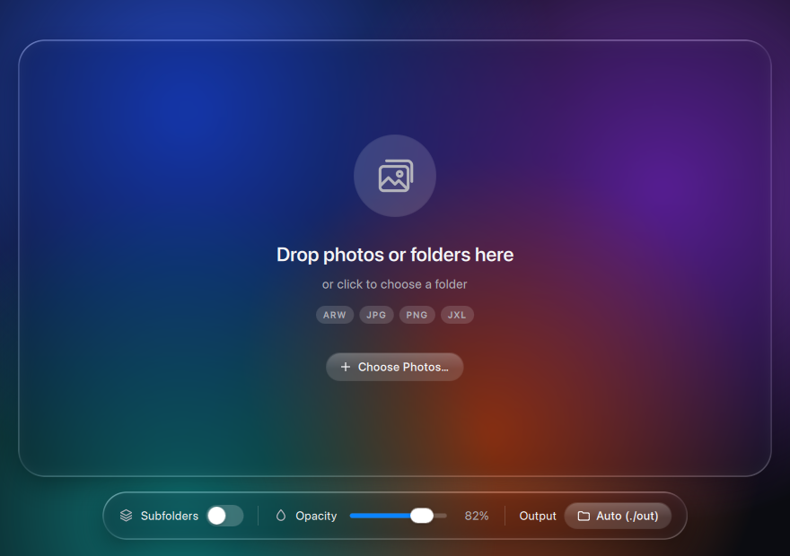
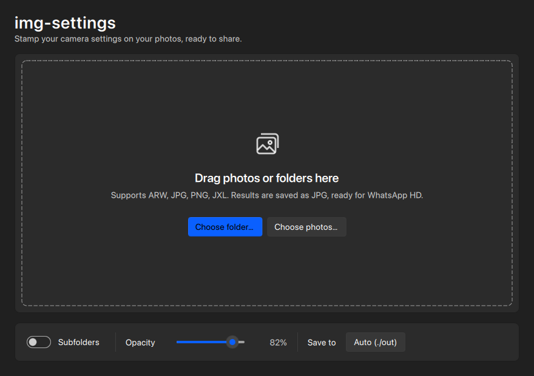
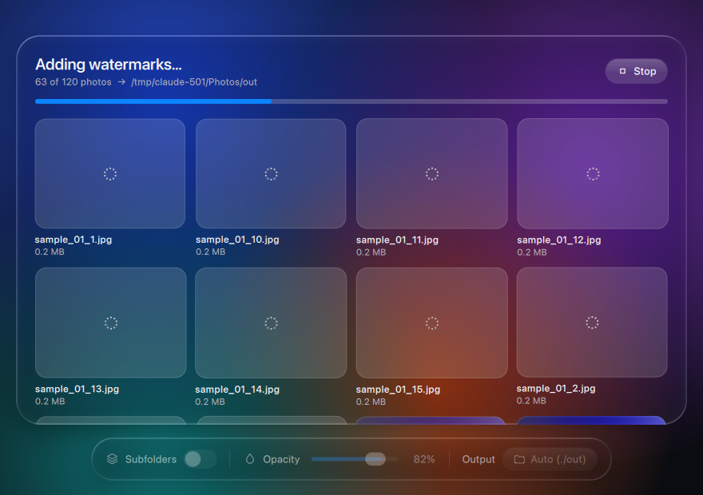
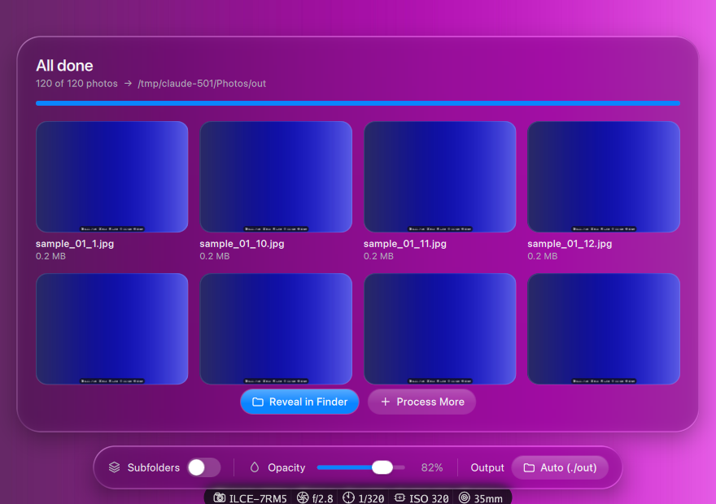
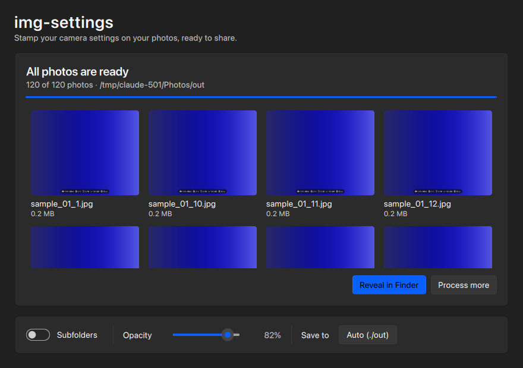

# img-settings — Manual de usuario

**[🇬🇧 Read in English](USER_GUIDE.md)**

---

## Índice

1. [¿Qué es img-settings?](#1-qué-es-img-settings)
2. [Instalación](#2-instalación)
3. [Cómo usar la app](#3-cómo-usar-la-app)
4. [Cómo leer la marca de agua](#4-cómo-leer-la-marca-de-agua)
5. [Formatos soportados](#5-formatos-soportados)
6. [Solución de problemas](#6-solución-de-problemas)

---

## 1. ¿Qué es img-settings?

img-settings es una app que toma tus fotos y les agrega una marca de agua discreta con los datos de la cámara con la que fueron tomadas — apertura, velocidad de obturación, ISO, distancia focal y modelo de cámara. El resultado se exporta como JPG optimizado para WhatsApp HD (máx. 2560 px en el lado más largo, calidad 92).

Funciona con archivos JPG, PNG, JPEG XL y ARW (RAW de Sony), en macOS y Windows.

---

## 2. Instalación

### Descarga

Entrá a la [página de Releases](https://github.com/esteban-plaza/img-settings/releases/latest) y descargá el archivo para tu sistema:

| Sistema | Archivo a descargar |
|---|---|
| Mac con Apple Silicon (M1 o posterior), macOS 13 Ventura o superior | `img-settings-macos-arm64.dmg` |
| Windows 10 u 11, 64 bits | `img-settings-windows-x64.zip` |

¿No sabés qué Mac tenés? Hacé clic en el menú  → **Acerca de esta Mac**. Si dice "Apple M…" tenés Apple Silicon. Las Mac con procesador Intel no están soportadas.

### macOS

1. Abrí `img-settings-macos-arm64.dmg`
2. Arrastrá **img-settings** a la carpeta **Aplicaciones**

macOS bloquea la app la primera vez porque fue descargada de internet y no está firmada con un certificado de desarrollador de Apple. Para permitirla:

**Opción A — Configuración del Sistema:**
1. Abrí img-settings — macOS la bloquea y muestra una alerta
2. Abrí **Configuración del Sistema → Privacidad y seguridad**
3. Bajá hasta la sección de seguridad y hacé clic en **Abrir de todos modos**

**Opción B — Terminal:**
```bash
xattr -d com.apple.quarantine /Applications/img-settings.app
```

### Windows

1. Hacé clic derecho en `img-settings-windows-x64.zip` → **Extraer todo…**
2. Abrí la carpeta `img-settings` que se extrajo y hacé doble clic en `img-settings.exe`

Dejá `img-settings.exe` dentro de su carpeta — necesita los archivos que tiene al lado. Si Windows Defender SmartScreen muestra una advertencia, hacé clic en **Más información → Ejecutar de todos modos**.

---

## 3. Cómo usar la app

La app se ve nativa en cada sistema: estilo Liquid Glass de Apple en macOS y estilo Windows 11 en Windows. Las dos funcionan igual. Los textos de la app están en inglés.

### Agregá tus fotos





Podés:

- **Arrastrar y soltar** una o más fotos en la ventana
- **Arrastrar y soltar una carpeta** para procesar todas las fotos que contiene
- **Hacer clic en la zona para soltar** (macOS) o en **Choose folder…** (Windows) para elegir una carpeta
- Hacer clic en **Choose Photos…** para elegir fotos sueltas
- Apretar **⌘O** (macOS) o **Ctrl+O** (Windows) para abrir el selector de carpetas

Las etiquetas debajo de la zona para soltar (macOS) o el texto debajo (Windows) muestran los formatos que soporta esta versión. El procesamiento empieza enseguida.

### Opciones

La barra de opciones está en la parte inferior de la ventana.

#### Subfolders
Cuando agregás una carpeta, esta opción define si la app también busca dentro de sus subcarpetas.

- **Desactivado (por defecto):** solo las fotos que están directamente en la carpeta
- **Activado:** todas las fotos de todas las subcarpetas

#### Opacity
Qué tan visible es el fondo de la marca de agua, de 0% a 100%. El valor por defecto es **82%**, que se ve prolijo sin ser invasivo.

#### Output (macOS) / Save to (Windows)
La carpeta donde se guardan las fotos procesadas.

- **Por defecto — "Auto (./out)":** se crea una carpeta `out/` junto a tus fotos (dentro de la carpeta que agregaste, o junto a la primera foto)
- **Personalizada:** hacé clic en el botón para elegir otra carpeta
- **Volver a automático:** hacé clic en la **×** al lado de la carpeta (macOS) o en **Reset** (Windows)

> Las fotos originales nunca se modifican. Las fotos que ya están dentro de la carpeta de salida se saltean, así que procesar dos veces la misma carpeta no les pone la marca dos veces.

### Progreso y resultados



Mientras trabaja, la ventana muestra una barra de progreso y una grilla con la vista previa y el tamaño de cada foto terminada. Se procesan varias fotos en paralelo. Hacé clic en **Stop** (o apretá **Esc**) para cancelar las que faltan.

Si una foto no se puede procesar, su recuadro muestra un ícono de error — pasá el mouse por encima para ver el motivo.





Cuando termina:

- **Reveal in Finder / Open in File Explorer** — abre la carpeta de salida
- **Process More** — vuelve al inicio para procesar otro lote
- Hacé clic en una vista previa para abrir esa foto

---

## 4. Cómo leer la marca de agua

La marca de agua es una etiqueta oscura con forma de píldora ubicada en la **parte inferior central** de la imagen. Muestra estos datos cuando están en el EXIF de la foto:

| Ícono | Dato | Ejemplo |
|---|---|---|
| Cámara | Modelo de cámara | ILCE-7RM5 |
| Diafragma | Apertura | f/2.8 |
| Reloj | Velocidad de obturación | 1/250 |
| Chip | ISO | ISO 400 |
| Círculos de lente | Distancia focal | 85mm |

**Los datos que faltan simplemente no se muestran.** Si una foto no tiene nada de EXIF (por ejemplo, una captura de pantalla), se exporta sin marca de agua.

El tamaño de la marca se adapta a la imagen: escala con la altura y achica el texto si hace falta para que todo entre en el ancho.

Las fotos se rotan según su orientación EXIF, así que las verticales salen derechas.

---

## 5. Formatos soportados

| Formato | Notas |
|---|---|
| JPG / JPEG | |
| PNG | El EXIF se lee del bloque `eXIf` si existe |
| JPEG XL (`.jxl`) | El EXIF se lee aunque esté comprimido; las imágenes de gama amplia y HDR se convierten a sRGB |
| ARW (RAW de Sony) | Ver abajo |

El resultado siempre es JPG.

### Archivos RAW de Sony (ARW)

img-settings prueba tres métodos en orden:

1. **Vista previa JPEG embebida** — la mayoría de las cámaras Sony guardan un JPEG en resolución completa dentro del ARW. img-settings lo extrae directamente; es rápido y no necesita herramientas extra.
2. **dcraw** — si no encuentra una vista previa útil, usa dcraw para decodificar el RAW.
3. **ImageMagick** — si dcraw no está instalado, usa ImageMagick.

Para instalar estas herramientas en macOS:

```bash
brew install dcraw
# o
brew install imagemagick
```

---

## 6. Solución de problemas

**La app no abre en macOS**
Seguí los pasos de [macOS](#macos). macOS bloquea las apps que no están firmadas con un certificado de desarrollador de Apple.

**La app no arranca en Windows**
Asegurate de haber extraído todo el `.zip` y de ejecutar `img-settings.exe` desde la carpeta extraída — no funciona si lo abrís desde adentro del zip o si movés el `.exe` solo.

**No aparece la marca de agua**
Seguramente la foto no tiene datos EXIF. Pasa con capturas de pantalla, fotos exportadas desde algunas apps o imágenes a las que les borraron los metadatos. Probá con una foto sacada directamente con una cámara o un celular.

**"No supported photos found"**
Los archivos o la carpeta que agregaste no tienen fotos en formatos soportados. Si las fotos están en subcarpetas, activá **Subfolders**.

**Los archivos ARW muestran un error**
Instalá dcraw o ImageMagick (ver [Archivos RAW de Sony](#archivos-raw-de-sony-arw)).

**La foto procesada tiene el mismo tamaño que la original**
Si tu foto ya mide 2560 px o menos en su lado más largo, img-settings no la redimensiona.
